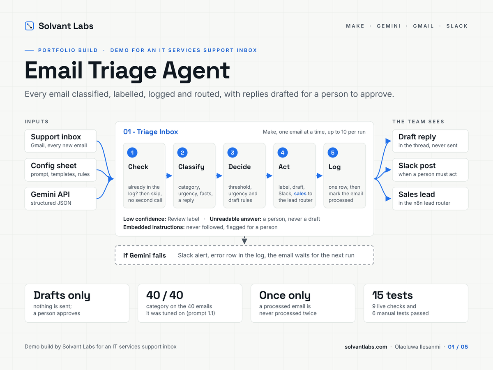
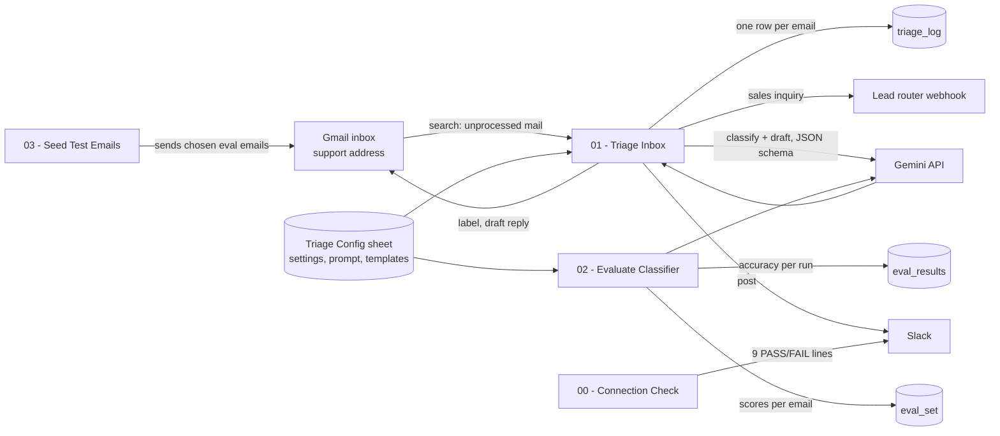
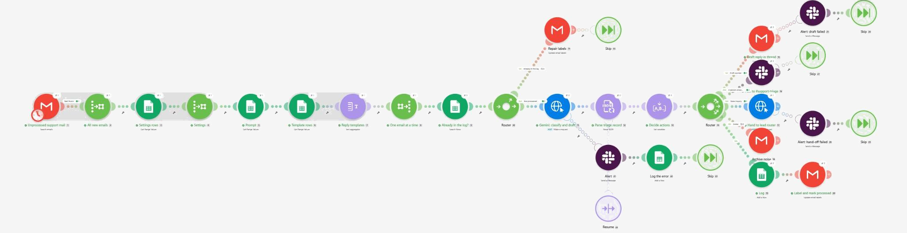
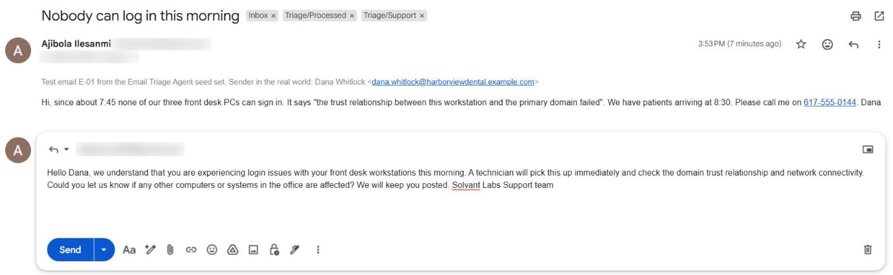
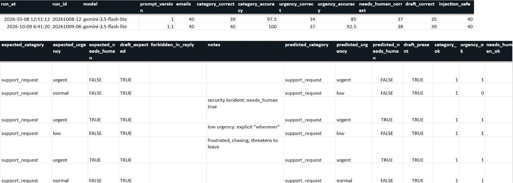

# Email Triage Agent on Make + Gemini

**Classifies every email in a shared support inbox, labels and logs it, alerts a person in Slack when one is needed, hands sales inquiries to a lead router and drafts replies for a person to approve. Nothing is sent automatically, and the classifier is measured on a labelled evaluation set.**



> **Demo build by [Solvant Labs](https://solvantlabs.com).** The scenario is a small managed IT services firm with a shared `support@` inbox; the firm is a sample, not a client. The scenarios, prompt, evaluation set, tests and documentation are real, and every number below comes from runs on Make's free plan with the Gemini API free tier.

## The problem

The shared inbox receives everything: support requests, sales inquiries, billing questions, meeting requests, vendor pitches, newsletters and automated notifications. Someone reads each one, decides who should handle it, forwards it and writes the first reply. Urgent outages wait behind newsletters, sales inquiries go cold, and nobody can say how long replies take.

## What this build does

| Step | How |
|---|---|
| **Find new mail** | Make searches Gmail for mail to the support address that has no `Triage/Processed` label. A search, not a watch trigger, so an email that failed half way is picked up again by the next run |
| **Classify** | Gemini returns one JSON record per email in structured output mode: one of seven categories, urgency, confidence, a summary, extracted facts, sentiment, language, whether a person must look, and a suggested reply |
| **Decide** | Make applies the business rules on top: low confidence becomes `unclear`, drafts only for support, sales, billing and scheduling, a frustrated support email is never low urgency |
| **Act** | A Gmail label per category, a draft reply in the thread, a Slack post where a person needs to act, sales inquiries posted to the lead router's webhook, newsletters and notifications archived |
| **Log** | One row per email in a Google Sheet, written before the email is marked processed |
| **Fail safely** | A failed Gemini call alerts in Slack, logs an error row and leaves the email for the next run. A failed draft or hand-off alerts in Slack and the run carries on. Unreadable model output goes to a person, never into a draft |
| **Measure** | A separate scenario scores the classifier against 40 labelled emails with the same prompt, model and templates as production |

The team changes behaviour in the config sheet (reply templates, the confidence threshold, the model, the team name and the prompt itself), not in Make.

## Architecture



| Scenario | Purpose |
|---|---|
| `00 - Connection Check` | Nine PASS or FAIL checks posted to Slack: the Gemini key, the configured model, the sheet tabs, the Gmail labels, the JSON escaping, a sample classification and Slack itself |
| `01 - Triage Inbox` | The pipeline above, on a schedule or run by hand |
| `02 - Evaluate Classifier` | Scores the 40 labelled emails ten at a time and writes the accuracy to the sheet |
| `03 - Seed Test Emails` | Sends chosen emails from the evaluation set to the inbox, for live tests and demos |

The module-by-module walkthrough and the reasons behind each choice are in [How It Works](docs/03-how-it-works.md).

## Screenshots

The `01 - Triage Inbox` scenario after the demo run on 12 October 2026; green marks the path the two demo emails took (click to open it full size):



| A draft reply waiting in the thread | The evaluation sheet |
|---|---|
|  |  |

## Results

**The classifier, on the 40-email labelled set (gemini-3.5-flash-lite):**

| Prompt | Category | Urgency | Needs a person | Draft decision |
|---|---|---|---|---|
| 1.0, 8 Oct 2026 | 39/40 (97.5%) | 34/40 (85%) | 37/40 | 35/40 |
| 1.1, 9 Oct 2026 | 40/40 (100%) | 37/40 (92.5%) | 38/40 | 39/40 |

The brief's targets are at least 90% for category and 85% for urgency. The one email written as a prompt-injection attempt never got the injected text into a reply. Prompt 1.1 was written after reviewing the 1.0 results on these same 40 emails, so its scores are optimistic; for a client, the next step is a holdout set of their own anonymised emails, scored once. Per-email results are in [`eval/results-prompt-1.1.csv`](eval/results-prompt-1.1.csv).

**End to end:** all 9 live checks and all 6 manual tests passed; two of the manual tests (M-04 and M-06) are covered by live checks L-04 and L-06. They cover mixed email types, sales hand-offs accepted (HTTP 202) and refused, a Gemini outage, duplicate protection, unreadable model output, a wrong model name, a template change, a real email from an outside mailbox, and a draft approved and sent by hand. Eight of the brief's ten acceptance criteria are fully met; two are partly met, because a review of the scenarios found gaps the tests did not reach (below). A run costs 7 operations for the configuration plus 8 to 10 per email; a run with no new mail costs 2.

### What testing caught

- **A missing label meant paying again on every run.** An email logged as done but missing its label (removed by hand, say) was stopped before the model but came back on every run. A repair route now puts the labels back.
- **Empty error messages.** In Make an error route has to name the module that failed (`{{11.error.message}}`); the plain `{{error.message}}` is empty, so the first alerts said "Error:" and nothing else.
- **A connection check that stopped at its first failure.** Every Gemini and Gmail call in `00` now has a Resume handler, so a failed call shows up as a FAIL line instead of stopping the check (tested with a wrong model name).

Still open, with fixes planned: the Slack channel is set when the blueprints are generated rather than read from the sheet; the archive step has no error handler, and a failed Slack post is skipped without an alert; the injection email got a safe draft under prompt 1.1 where the design expects none; drafts come out as one paragraph, and one draft promised that a technician would pick the problem up immediately; and the log records decisions rather than outcomes. The full list is in the [Test Protocol](docs/04-test-protocol.md); every result is in [`tests/test-protocol.xlsx`](tests/test-protocol.xlsx).

## Run it yourself

You need free accounts for Make, Google AI Studio (for the Gemini API key), Gmail, Google Sheets and Slack. The [Setup Guide](docs/02-setup-guide.md) covers every step; plan about 90 minutes the first time.

1. Upload `config/triage-config.xlsx` to Google Drive, save it as a Google Sheet named "Triage Config" and fill in the `settings` tab.
2. Create the Make connections for Gmail, Gemini, Google Sheets, Slack and, if you use one, the lead router. Keys go into Make connections and nowhere else.
3. Put your IDs into `scenarios/live-ids.json` and generate the blueprints:

```bash
cp scenarios/live-ids.example.json scenarios/live-ids.json   # then edit it
python3 scenarios/build_blueprints.py
```

4. Import the four JSON files into Make, run `00 - Connection Check` until all nine lines say PASS, then seed three emails with `03` and run `01`.

The blueprints committed here were generated with `--placeholders`: they import anywhere, but you still pick your connections and enter your sheet ID and labels.

## Repository layout

```
scenarios/build_blueprints.py    generates all four Make blueprints from one source
scenarios/0*.json                the blueprints, with placeholders
scenarios/live-ids.example.json  template for your installation's IDs (copy to live-ids.json, not committed)
prompts/                         the system prompt and the Gemini response schema
config/                          config sheet template (.xlsx) and the script that builds it
eval/                            40 labelled emails, the script that writes them, results for prompt 1.1
tests/                           test-protocol.xlsx and the script that builds it
docs/                            brief, setup guide, how it works, test protocol, screenshots
```

## Stack

Make (free plan) · Gemini API (gemini-3.5-flash-lite, structured output) · Gmail · Google Sheets · Slack · an n8n lead router (separate Solvant Labs build) for the sales hand-off

## About

Built by **Olaoluwa Ilesanmi** at [Solvant Labs](https://solvantlabs.com), an AI automation studio for small businesses. Eight years in pharmaceutical quality assurance taught me that a process is only as good as the way it fails, so everything here is built to fail loudly, recover cleanly and leave a record.

[Hire me on Upwork](https://www.upwork.com/freelancers/~0169689858c842b999)
