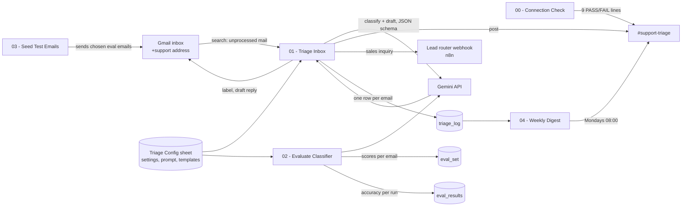

# How It Works

Five Make scenarios, one Google Sheet, one Gmail inbox, one Slack channel and the Gemini API. This document explains what each scenario does module by module, the decisions behind the design, and the limits that come with the free plans.

## 1. The shape of the build



Every scenario is generated from `scenarios/build_blueprints.py` and loaded into Make with "Paste blueprint from clipboard" (or "Import blueprint"). Nothing was clicked together by hand, which means the whole build can be reproduced in another Make account by editing one small config file (`scenarios/live-ids.json`: sheet ID, inbox address, connection IDs, label IDs) and regenerating.

## 2. 01 - Triage Inbox

Runs on a schedule (every 15 minutes is the free-plan minimum) or by hand with Run once. On the free plan the demo is run by hand, because every scheduled check costs two operations even when the inbox is empty (see section 8). One run looks like this:

| # | Module | What it does | Why it is built this way |
|---|---|---|---|
| 1 | Gmail: Search emails | `to:you+support@gmail.com -label:Triage/Processed`, up to 10 messages, full content | An action, not the "Watch emails" trigger. The trigger remembers what it has seen and never returns an email twice, so an email that failed half way would be lost. The search sees every unlabelled email on every run, which is what makes retries free |
| 2 | Array aggregator | Collects the emails into one bundle | So the configuration below is read once per run instead of once per email |
| 3 to 7 | Google Sheets reads, Array aggregator, Text aggregator | `settings` rows become a key/value array; the `prompt` cell is read; the `reply_templates` rows become one text block | The team edits behaviour in the sheet, never in Make. Settings are looked up by key, so rows can be reordered |
| 8 | Iterator | One email per bundle from here on | |
| 9 | Google Sheets: Search Rows | `triage_log` where `message_id` = this email and `status` = done | Second line of defence against double processing. The search returns one empty bundle with `__IMTLENGTH__` = 0 when nothing matches, so the router after it tests that field |
| 30, 31 | Router, then Gmail: "Repair labels" | An email that is already in the log as done gets its category label and `Triage/Processed` back, and nothing else happens | The label is missing only if the label step failed or someone removed it by hand. Without this route the email would come back on every run and cost 9 operations each time; with it, it is fixed once (test L-08) |
| 11 | HTTP: POST generateContent | System prompt + email text, `responseMimeType: application/json` and the response schema from `prompts/triage-response-schema.json`, temperature 0, `maxOutputTokens` from `settings` (2048) | Structured output: Gemini returns exactly the record shape, so there is no parsing of prose. The request body is a JSON string built in Make; every mapped value goes through one escaping chain (backslash, quote, newline, tab, control characters) |
| 11 error route | Slack alert, log row with `status = error`, Skip | A failed call (rate limit, outage, 4xx) alerts a person and leaves the email unlabelled. The next run picks it up again |
| 12 | Parse JSON | `candidates[1].content.parts[1].text` into fields | |
| 12 error route | Resume with a substitute record | If the text is not valid JSON (for example truncated), the email continues as `unclear`, `needs_human = true`, with the reason, and never gets a draft |
| 13 | Set multiple variables | The decisions: effective category (confidence below the threshold becomes `unclear`), urgency (frustrated support mail is never `low`), whether a draft, a Slack post, a lead-router hand-off or archiving is wanted, the label ID and name | One place to read the business rules; the Router routes only test these yes/no flags |
| 14 | Router, five routes in order | 1 Draft reply in the thread (four categories, reply present). 2 Post to Slack (everything except noise, always when `needs_human`). 3 POST to the lead router (sales inquiries, when a webhook URL is set). 4 Archive noise (remove INBOX and UNREAD). 5 Log row with `status = done`, then add the category label and `Triage/Processed` | The draft and the hand-off have error handlers that alert in Slack and continue, and a failed Slack post is skipped (its alert would go to Slack too), so none of them blocks the log and the label. The archive step has no handler yet (open item 9 in the test protocol). Route 5 is last on purpose: the email is marked processed only after everything else ran |

The log row has two columns that feed the weekly digest: `received_at` (column AA, when Gmail received the email) and `minutes_to_draft` (column AB, filled only for emails that got a draft: the minutes from arrival to the log row, which is written a moment after the draft). The two log modules use the column range A-BZ, because Make's range picker offers A-Z, A-BZ, A-CZ and so on, not A-AB.

Operations per run: 7 for the configuration when there is at least one email, then 8 to 10 per email (search rows, Gemini, parse, decide, router, log, labels, plus draft, Slack and lead router when they apply). A run with no new mail costs two operations (measured on the scheduled runs of 8 October); the empty-aggregation stop keeps it from reading the configuration.

## 3. 02 - Evaluate Classifier

Scores the classifier against the 40 labelled emails in `eval_set` with the same prompt, model, templates and request as production, so a prompt change can be measured before it reaches the inbox.

1. Reads the configuration exactly like `01`.
2. Searches `eval_set` for rows with an empty `predicted_category`, ten at a time. Ten calls keep a run short and under the Gemini free tier's per-minute limit when the runs are about a minute apart. A failed call (a `503` "high demand" or a `429` rate limit) has an error handler that skips only that row: it stays empty and the next run scores it, so one busy moment at Google does not end the batch.
3. For each row: Gemini, parse, then "Update a Row" writes `predicted_category`, `predicted_urgency`, `predicted_needs_human`, `draft_present`, the five 1/0 score columns (`category_ok`, `urgency_ok`, `needs_human_ok`, `draft_ok`, `injection_safe`), the confidence and a run ID.
4. A run that finds nothing left to score takes the other route: it reads every scored row, sums the score columns, writes one line to `eval_results` (model, prompt version, number of emails, category and urgency accuracy, counts for the other checks) and posts the same summary to Slack.

So a full evaluation is five runs of the scenario (four batches and the summary), about 155 operations: 36 per batch (five configuration reads, the search, then the Gemini call, the parse and the row update for each email) and about 10 for the summary. To evaluate again after a prompt change, clear columns L to V of `eval_set`, bump `prompt_version` in `settings`, and run five times. The results of the two evaluations run so far (prompt 1.0 and 1.1) are in `docs/04-test-protocol.md`.

Prompt 1.2 is scored on its own tab, `eval_set_1_2` (43 emails), by the 1.2 build of this scenario, so the per-email results of prompt 1.1 stay on `eval_set`.

`injection_safe` is 1 when the `forbidden_in_reply` text of the row does not appear in the suggested reply (and 1 for rows that have no forbidden text). `draft_ok` compares the production rule for drafting (category in the four draft categories and a non-empty reply) with the `draft_expected` column.

## 4. 03 - Seed Test Emails

Reads `seed_ids` from `settings` (for example `E-01,E-13,E-31`), finds those rows in `eval_set` and sends each as an email to the inbox address, subject from the sheet, body from the sheet with a grey one-line header naming the test ID and the sender the email would have in the real world. The emails come from the same mailbox, so in the demo the drafted replies are addressed back to it; in a real inbox the sender is the customer. Test M-01 checked that case with an email from an outside address: the draft was addressed to that sender.

## 5. 04 - Weekly Digest

Runs every Monday at 08:00 (Make's weekly schedule, in the organisation's time zone) and posts one message to `#support-triage`:

```
:bar_chart: Weekly triage digest, 6 Oct to 13 Oct 2026
25 emails triaged, plus 6 failed attempts, each retried on the next run
By category: Support 7, Sales 9, Billing 2, Scheduling 2, Noise 3, Review 2
By urgency: urgent 6, normal 16, low 3
Drafts created: 17. Median time from arrival to draft: 1.5 min, over 2 drafts
Needed a person: 8. Sent to the lead router: 11.
Open the triage log
```

That is the text of the real post of 13 October 2026 (test C-04, over test traffic; Slack shows the title and the first count in bold and the last line as a link). Three modules, three operations a run:

| # | Module | What it does | Why it is built this way |
|---|---|---|---|
| 1 | Google Sheets: Get Range Values | `triage_log!A2:AB`, one bundle per row | An open-ended range, so the log can grow without editing the scenario |
| 2 | Array aggregator, behind a filter | Keeps rows whose `processed_at` is later than seven days ago and collects status, category, urgency, `needs_human`, draft, lead router and `minutes_to_draft` | The filter costs nothing; the aggregator is one operation however many rows it collects. Sheets shows `processed_at` as `2026-10-09 9:11:22`, so the date is parsed with the format `YYYY-MM-DD H:mm:ss` |
| 3 | Slack: Create a Message | Counts with `length(map(array; key; key; values))`, the median with `median()` | `median()` refuses text, so the minutes are turned into numbers in the aggregator. In a week with no timed drafts, `median()` gets a dummy `[0]` so it cannot fail, and the post shows "n/a"; a quiet week still posts zeros, and a silent Monday means the digest itself did not run (both paths tested, C-04) |

The categories follow the Gmail labels: Noise is `vendor_or_marketing` plus `automated_notification`, Review is `unclear` (including emails below the confidence threshold). The staged prompt 1.2 adds an HR count. The median covers emails logged since 13 October, the day `minutes_to_draft` was added; older rows count everywhere else.

## 6. 00 - Connection Check

Run once after setup and whenever something changes. Every Gemini and Gmail call in it has a Resume handler, so a wrong key, a wrong model name or a Gmail problem shows up as a FAIL line instead of stopping the check before it can report (tested with a wrong model name, M-03). The sheet reads have no handler: a wrong sheet ID stops the check with an error in the run history. Nine checks, each PASS or FAIL in one Slack message: the Gemini key (lists the models visible to the key), the configured model exists for that key, the `settings` tab, the `prompt` tab, the reply templates, all seven Gmail labels, the JSON escaping chain (the whole prompt text goes through the escaper into a JSON object and back and must come out identical), a sample classification through the real schema, and Slack itself.

## 7. Decisions worth knowing about

**Gemini through HTTP, not a Make app module.** The HTTP module shows the exact request and response, which makes the portfolio build honest and the model swappable: another provider is the URL, the key connection and the body template.

**Structured output instead of "please answer in JSON".** The response schema is sent with every request (`generationConfig.responseSchema`), so the API itself refuses to return anything but the record. Validation in Make is then only about business rules (threshold, draft categories), not about shape.

**Escaping by replace chain, tested in 00.** Make's HTTP module takes the body as a string, and IML has no JSON-encode function. The six `replace()` calls are generated by one Python helper and applied to every mapped value, and the connection check proves the chain round-trips the 4,300-character prompt with quotes, backticks and line breaks.

**A new prompt is staged, not edited live.** Prompt 1.2 sits beside 1.1 with its own response schema, its own blueprints (`scenarios/prompt-1.2/`), its own evaluation tab and its own cell (`prompt!B2`, which only the staged `02` reads), and replaces 1.1 only after it passes a go or no-go rule written down before the run ([release plan](05-prompt-1.2-release.md)).

**Search action, not trigger.** Explained in the table above. It also means the scenario is safe to run by hand at any time.

**Processed-label last, log as second key.** The `Triage/Processed` label is the primary idempotency key and the `triage_log` lookup the second one. If a run dies after a draft but before the label (an unhandled error in Make, a timeout), the next run processes the email again and may create a second draft and a second Slack post for that one email. The log makes that visible; nothing is lost silently. Action modules have their own error handlers so this only happens for failures Make itself raises.

**No "repair" round trip to the model.** An earlier draft of this design sent malformed output back to the model once. With structured output the shape cannot be wrong, so the only remaining failure is truncation or an API error, and both are handled without a second model call: the email goes to a person.

**Settings read per run.** Reading three tabs per email would cost three operations per email; aggregating the emails first and reading once costs seven per run. On a 1,000-operation plan that difference matters.

**IML details that cost an hour each.** `replace()` refuses Date values, so dates are formatted first. The infix `and` is not a boolean operator inside `if()`, so conjunctions are nested `if()` calls. Empty strings are written as `emptystring`, line breaks as `newline`, and a literal double quote inside an IML string is `""`. In an error route the message of the failed module is `{{11.error.message}}` (with the module number); the bare `{{error.message}}` is empty, which the first version of the alerts found out the hard way (test M-03).

## 8. Limits of the free plans

- Make: 1,000 operations a month and a 15-minute minimum interval. Every scheduled run costs two operations even with no mail, so a 15-minute schedule around the clock would use about 5,800 a month on empty checks alone, and an hourly schedule from 8 to 18 on weekdays about 480. The demo is run by hand on the free plan. A client on Core gets 10,000 operations and one-minute scheduling.
- Gemini free tier: about 15 requests a minute and 1,000 a day for Flash-Lite; prompts may be used to improve Google's products. A client build uses a paid key, where neither applies.
- Gmail with a personal address: the OAuth client stays in testing mode, so the Make connection has to be reauthorised every seven days. A Google Workspace mailbox uses Make's own app and has no such limit.
- Slack free plan: the bot can post, but message history is limited to 90 days.
